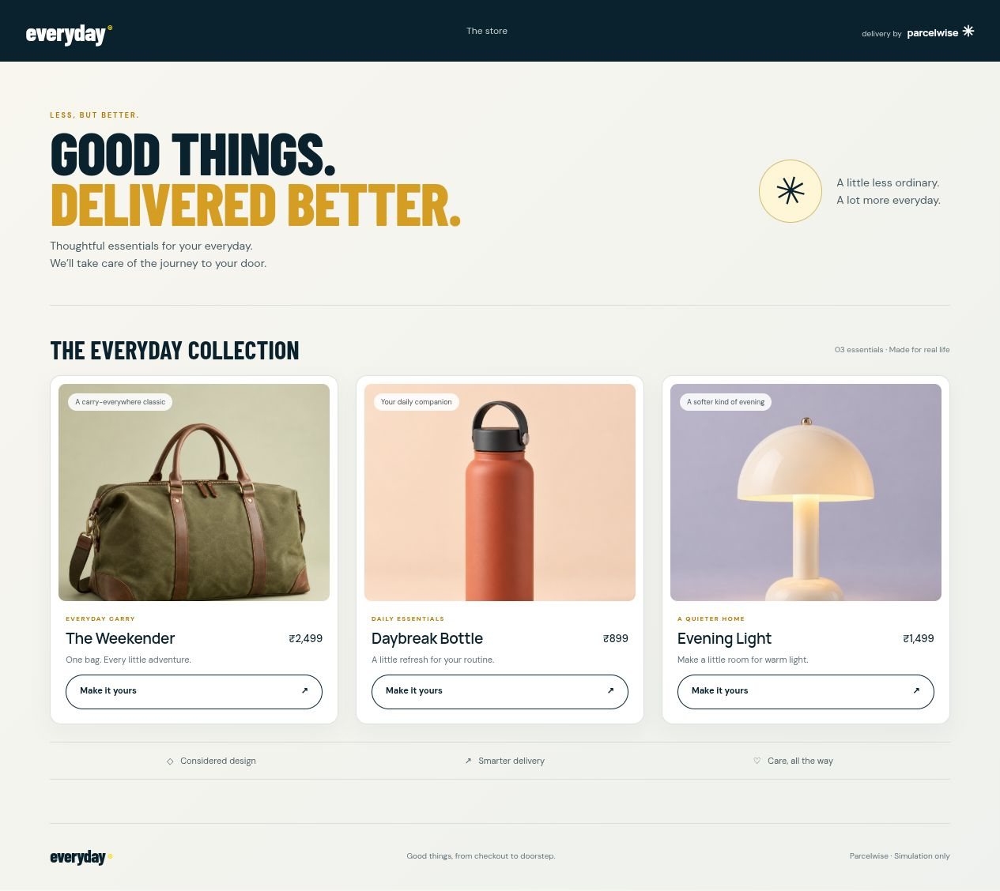
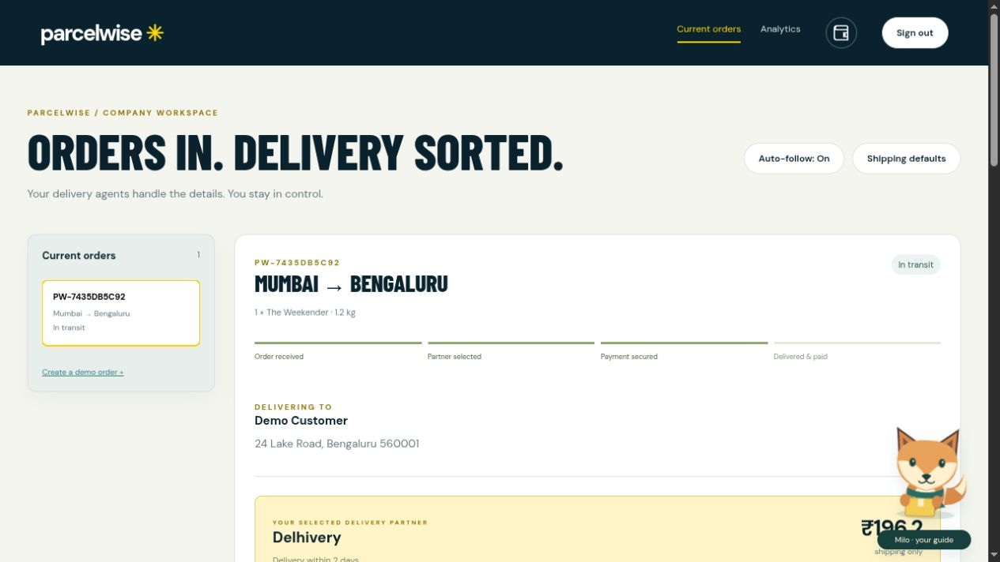
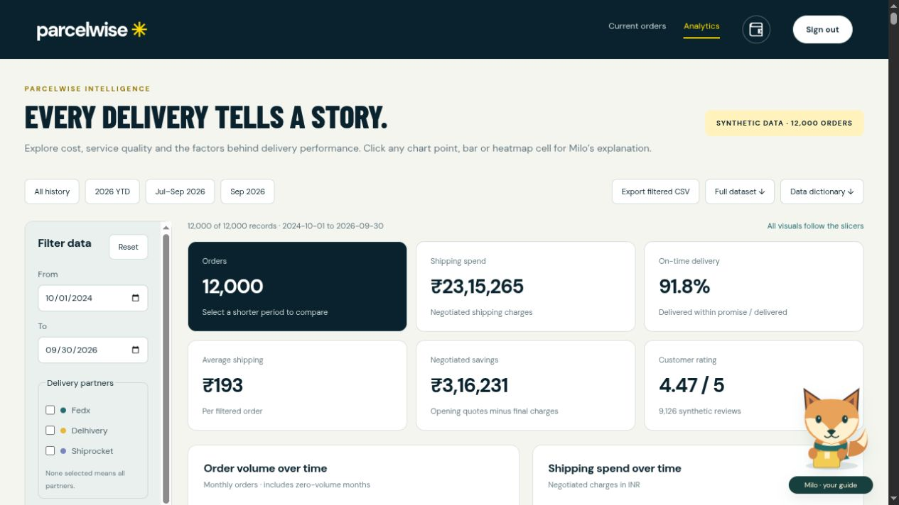
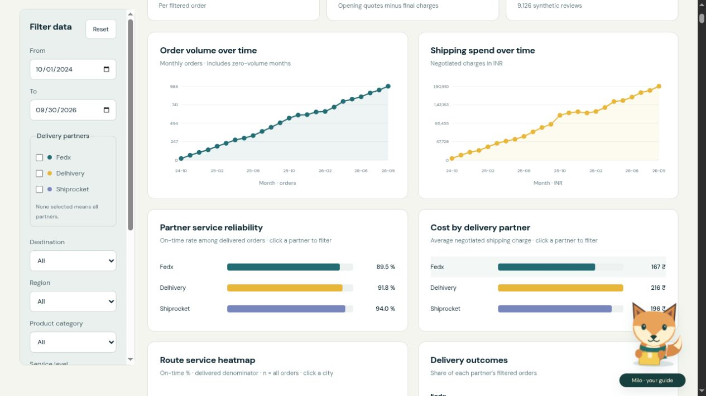
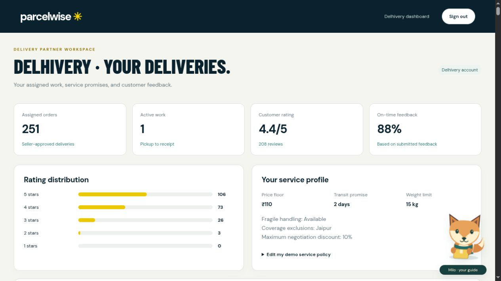
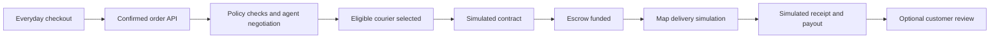

# Parcelwise × Everyday

**From checkout to courier selection, escrow and delivery — one connected demo.**

Parcelwise connects an ecommerce storefront, a seller workspace and separate courier workspaces. Policy-bound agents negotiate delivery prices, the server selects an eligible partner, and an automatic simulation shows the contract, escrow funding, transit and payout. Analytics helps explore delivery cost, reliability and customer experience.

Built with **Python · SQLite · Vanilla JavaScript · Leaflet/OpenStreetMap · optional OpenAI Responses API**. No pip or npm dependencies are required to run the app.

[Quick start](#quick-start) · [Screenshots](#screenshots) · [Demo accounts](#demo-accounts) · [How it works](#how-it-works) · [Analytics](#analytics) · [Configuration](#configuration) · [Tests](#tests)

> This is a local demonstration. Courier services, contracts, wallets, escrow and delivery positions are simulated. OpenAI proposals and SMTP email are optional external integrations.

## Screenshots

Captured from the current application using an isolated sample database. All customer details shown are fictional. The populated courier history is screenshot fixture data; a fresh operational database starts without those sample deliveries.

### Everyday storefront

Three everyday products, parcel-aware checkout and an order-confirmation screen with customer tracking.



### Seller workspace

Current orders, customer delivery details, the selected courier and the delivery lifecycle in one workspace.



### Delivery intelligence

A dedicated analytics experience with shared filters, interactive visualizations and a fictional 12,000-order dataset.





### Courier workspace

Each courier sees its own assignments, rating distribution, service policy and customer feedback.



## Quick start

Requires **Python 3.10+**. Node.js is only needed for JavaScript tests. Internet access is needed for external map tiles and optional integrations.

```sh
git clone https://github.com/Preethesh16/parcelwise.git
cd parcelwise
python3 run_demo.py --store-port 8002 --api-port 8001
```

| Experience | Local URL |
|---|---|
| Landing page | [localhost:8002](http://localhost:8002/) |
| Everyday shop | [localhost:8002/shop](http://localhost:8002/shop) |
| Seller login | [localhost:8001/#login=seller](http://localhost:8001/#login=seller) |
| Courier login | [localhost:8001/#login=partner](http://localhost:8001/#login=partner) |
| Seller analytics | [localhost:8001/#analytics](http://localhost:8001/#analytics) |
| Seller shipping rules | [localhost:8001/#connections](http://localhost:8001/#connections) |

The command above uses port **8002** for the store and **8001** for Parcelwise. Running without flags uses **8000/8001**. Choose other ports if occupied; the runner updates cross-service URLs. Both services bind to `127.0.0.1`. Stop them with **Ctrl+C**. Existing SQLite data is retained between runs.

## Demo accounts

Choose an account on its sign-in page and enter the matching access key.

| Workspace | Login route on the API port | Demo access key |
|---|---|---|
| Everyday Store seller | `/#login=seller` | `demo-company-key` |
| Fedx | `/#login=A` | `demo-partner-A-key` |
| Delhivery | `/#login=B` | `demo-partner-B-key` |
| Shiprocket | `/#login=C` | `demo-partner-C-key` |

These are the three carrier profiles in the current version. Carrier names represent simulated accounts, not connected commercial services. Shared demo keys are intentionally public; they are not production credentials. Sessions expire after eight hours or a server restart. Courier APIs scope assignments to the signed-in partner. Seller and courier workspaces can remain open in separate tabs.

## How it works



1. **Order:** checkout saves the purchase and sends an authenticated order event to Parcelwise. The customer receives confirmation and a tracking link.
2. **Negotiate:** seller and courier agents exchange three rounds of proposals within saved policies. The seller workspace shows the conversation and offers.
3. **Choose:** the server ranks eligible offers and automatically selects the recommendation after a visible pause.
4. **Secure:** a simulated delivery contract records the agreed terms. The ledger moves demo credits from the company wallet into escrow exactly once.
5. **Deliver:** a durable worker advances pickup, transit, out-for-delivery and arrival. The map follows simulated city-to-city positions; the process survives page refreshes and server restarts.
6. **Settle:** new automatic demos simulate recipient confirmation and release escrow. This is explicitly a simulated receipt, not a real customer confirmation. No customer rating is invented.
7. **Review:** customers can submit feedback after delivery. Courier history and operational feedback reflect persisted orders. Completed work leaves Current orders and remains available in history.

No eligible offer or insufficient funds stops the flow for review. Existing bookings retain their agreed terms. Older manual workflows remain supported.

### Rules enforced by the server

| Rule | Behavior |
|---|---|
| Budget | Final shipping price must fit the seller's budget |
| Deadline | Uses the stricter customer/seller deadline |
| Serviceability | Checks route coverage, exclusions and courier availability |
| Parcel size | Billable weight is the greater of physical weight and volume / 5,000 |
| Handling | Fragile requirements cannot be relaxed; lamps require fragile handling |
| Reliability | Candidates must satisfy the seller's minimum reliability |
| Courier policy | Enforces price floor, discount bounds, transit promise and weight limit |
| Ranking | Seller selects balanced, price, speed or reliability priority |

## Analytics

The seller's business-intelligence dashboard uses **12,000 fictional orders**, covering **October 2024–September 2026**, with **31 fields** and seed `16102026`. This static dataset is separate from operational SQLite orders, wallets, bookings and email. New checkouts do not become synthetic chart rows; operational history is shown separately.

- Combined date, courier, destination, region, product category, service, payment, outcome, weather and handling filters.
- Ten visual panels, KPI cards, carrier scorecard, correlation explorer and a detailed order table.
- Clickable carrier, city and product visuals to filter the cohort; Reset clears selections.
- Filtered CSV export includes all matching records, not just the visible table page.
- On-time rate uses delivered orders; average ratings exclude unrated records. Correlations exclude missing pairs and describe association, not causation. Scatter plots sample dots while statistics use all valid pairs.

Explore the [JSON dataset](static/data/synthetic_orders.json), [CSV dataset](static/data/synthetic_orders.csv) and [data dictionary](static/data/data_dictionary.csv). Differences between carriers are simulation assumptions, not claims about real companies.

## Configuration

### Negotiation mode

Without a key, negotiations use explicitly labelled local policy agents. To enable live proposals, set `OPENAI_API_KEY` in the **server environment** before starting. Do not put it in frontend code or commit it.

| Variable | Purpose |
|---|---|
| `PARCELWISE_AI_MODE` | `local` forces offline proposals; `openai` requires a key |
| `OPENAI_API_KEY` | Server-side OpenAI credential |
| `OPENAI_MODEL` | Defaults to `gpt-4.1-mini` |
| `PARCELWISE_DB` / `EVERYDAY_DB` | Override the two SQLite database paths |
| `PARCELWISE_API_URL` | Store-to-API internal URL |
| `PARCELWISE_PUBLIC_URL` | Customer-facing Parcelwise URL |
| `EVERYDAY_PUBLIC_URL` | Store URL used by the runner |
| `PARCELWISE_COMPANY_KEY` | Store's order-ingestion credential; must match the API configuration |

Seller and courier agents make separate structured-output requests, up to 18 calls for three eligible carriers over three rounds. Requests include logistics and policy data, not customer names, street addresses or tracking tokens. The adapter uses `store=false`, validates prices against server bounds and caches successful proposals. Provider failures do not silently fall back to local proposals. Restart after changing environment variables.

### Optional confirmation email

Carrier selection creates a persistent email-outbox entry. Email runs independently of delivery; without SMTP configuration it remains queued with a sender-setup message.

For Gmail, run `python3 setup_gmail.py` and enter an app password at the hidden local prompt, then restart the runner. SMTP settings are loaded from Git-ignored `.env`; see [.env.example](.env.example). The current recipient is fixed in [delivery_email.py](delivery_email.py), so review it before enabling sending. SMTP acceptance does not guarantee inbox delivery, and ambiguous submissions are not automatically resent.

The runner reads SMTP settings from `.env`; export OpenAI settings in the process environment.

## Architecture and persistence

```text
Browser
 ├── Everyday storefront → storefront.py → store.sqlite3
 │                              │ authenticated order event
 └── Seller / courier portals → server.py → workflow.py → data.sqlite3
                                  ├── negotiation_ai.py (local / OpenAI)
                                  ├── delivery_email.py (optional SMTP)
                                  └── static/analytics.js + synthetic dataset
```

| File or directory | Responsibility |
|---|---|
| `run_demo.py` | Starts both services and configures their URLs |
| `storefront.py`, `storefront/` | Shop, checkout, confirmation and retry persistence |
| `server.py`, `portal_auth.py` | HTTP API, sessions and role checks |
| `workflow.py` | Negotiation, selection, contracts, escrow and delivery state machine |
| `negotiation_ai.py` | Validated agent proposals and persistent proposal reuse |
| `static/` | Seller/courier UI, map, analytics and Milo guide |
| `test_*.py`, `test_*.js` | Isolated backend and frontend checks |
| `docs/screenshots/` | Repository-hosted README screenshots |

`store.sqlite3` stores confirmed checkout payloads and retry state. `data.sqlite3` stores orders, policies, wallets, ledger entries, proposal cache and email outbox. Both are ignored by Git. Order IDs are idempotency keys; reuse with a changed payload is rejected. Funding and release are protected against duplicate ledger entries; delivery updates must be sequential.

### Main endpoints

| Endpoint | Purpose |
|---|---|
| `POST /api/v1/orders` | Authenticated order ingestion; returns HTTP 202 and starts the automatic flow |
| `GET /api/platform` | Role-scoped workspace data |
| `GET /api/v1/orders/{id}` | Authorized order details |
| `POST /api/connections` | Account-owned policy changes |
| `POST /api/integrations/delivery` | Partner-key authenticated delivery update |
| `GET /api/tracking/{token}` | Customer delivery state |
| `POST /api/tracking-action` | Token-authorized receipt, issue or feedback action |
| `POST /api/login`, `POST /api/logout` | Local account sessions |

See [the example order payload](static/api-example.json). Customer tracking uses an unguessable token; browser portal requests use session cookies.

## Tests

Run from the repository root. Python tests use isolated databases; email tests mock SMTP.

```sh
python3 -m unittest discover -v
node test_workspace.js
node test_analytics.js
node test_journey.js
node --check static/workspace.js
node --check storefront/app.js
```

Coverage includes automatic and legacy flows, policy bounds, no-match cases, ledger conservation, restart recovery, sessions, courier ownership, feedback, AI proposal validation and analytics filtering.

## Demo scope

There are no real courier bookings, live GPS feeds, bank transfers or deployed blockchain contracts. The map uses Leaflet/OpenStreetMap with simulated positions. The application uses local shared accounts and one seller; it is not a production multi-tenant service. Production would require individual identity, comprehensive authorization, HTTPS, real carrier/payment integrations, proof of delivery and operational monitoring.

Implementation notes and previous verification records are in [progress.md](progress.md).
